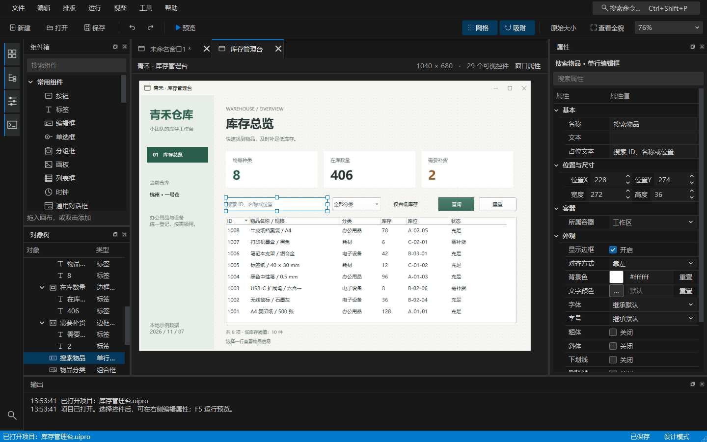
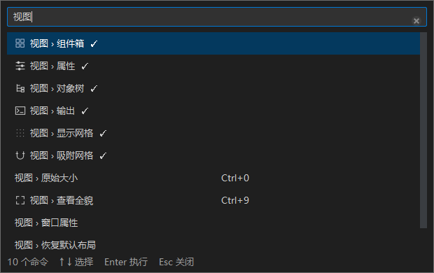

# VS Code 风格工作台

本轮在现有 Python / PySide6 设计器上统一界面与导航，保持 0.10.0 的项目格式和业务功能。参考 VS Code Dark Modern 的配色、连续面板、标签和操作密度。

## 操作

- 左侧活动栏依次控制组件箱、对象树、属性和输出，按钮状态随面板显示状态同步。面板仍可停靠、浮动，使用“视图 → 恢复默认布局”恢复。
- 点击右上角“搜索命令”，或按 Ctrl+Shift+P，按命令中文名称、菜单分类、快捷键搜索。多个词用空格分隔；方向键选择、回车执行、Esc 取消。不可用命令显示为灰色。
- 组件箱支持中文名称、别名和英文类型搜索，不区分英文大小写；搜索命中时展开分类，无结果时显示提示。
- 文档标签显示当前文件、未保存标记、保存中及只读状态。底部右侧显示保存状态和预览运行状态。
- 关闭全部项目后，空工作区提供新建、打开和命令搜索入口。
- 画布仍默认 100% 和左上定位。Ctrl+9 查看全貌，Ctrl+0 恢复原始大小。小屏幕可通过活动栏收起暂时不用的面板。

## 视觉与实现

| 用途 | 色值 |
| --- | --- |
| 标题、侧栏和活动栏 | #181818 |
| 编辑区域 | #1f1f1f |
| 输入背景与分隔线 | #313131 |
| 正文 / 次要文字 | #cccccc / #9d9d9d |
| 焦点、画布选框 | #0078d4 |
| 选中背景 | #04395e |
| 状态栏 | #007acc |
| 错误提示 | #f48771 |

颜色集中在 `resources/colors.py`，样式与调色板集中在 `app/designer_theme.py`。`app/theme.py` 保留兼容入口并复用同一主题，不再叠加浅色和深色两套样式。工具栏和树不再强制使用 8pt 小字；中文默认使用 9pt 微软雅黑 UI。

补齐了下拉、步进、折叠、复选、标签关闭、停靠和文件导航图标，以及焦点、悬停、禁用和错误状态。属性表采用连续行；编辑器在样式或字体变化后重新核对行高，保留输入状态，不因重建控件打断编辑。颜色、内容、菜单、文件和字体选择沿用现有编辑逻辑。

工作台主题在 MainWindow 上安装，不修改 QApplication 的全局调色板。运行时窗口保持独立，白色或彩色设计内容不会被强制改为深色。

命令搜索直接调用现有 QAction。菜单项可以在保存完成后更新，因此搜索结果只保存命令序号，执行前检查 QAction 是否仍有效，避免 QVariant 持有已删除的原生对象指针。重复打开命令面板不会销毁原菜单。

便携包配置已包含主题 SVG，源码指纹也覆盖颜色与图形资源。已有历史便携包不会随源码修改自动更新；需要新包时使用 `python -X utf8 scripts/build_release.py` 构建到独立时间戳目录。

## 验证

本轮报告与截图统一放在 `reports/vscode-workbench/`，不覆盖旧版本报告。

2026-11-09 本机实测：

| 检查 | 结果 |
| --- | --- |
| 全量回归（应用与架构实验） | 868 通过，507.97 秒 |
| 最终工作台专项 | 26 通过，含新增的 7 项导航与命令生命周期检查 |
| Windows 源码交付检查 | 保存、加载、导出、37 类组件及独立预览启动 / 停止通过 |
| 100%、150%、200% 桌面检查 | 每档 12 张截图；启动范围、面板切换、主题隔离、属性行高通过 |

改动前的主题基线有 1 项属性行高检查失败，本轮已修复。最终工作台专项在命令搜索的生命周期修复后执行；全量回归与专项覆盖存在重叠，不应把两者直接相加为独立测试数。

```powershell
python -m pytest -q --junitxml=reports/vscode-workbench/regression.xml
python -m pytest tests/test_workbench_commands.py tests/test_designer_theme.py tests/test_project_file_dialog.py tests/test_window_geometry.py -q --junitxml=reports/vscode-workbench/workbench-tests.xml
python -X utf8 main.py --release-check reports/vscode-workbench/release-check.json
python -X utf8 scripts/capture_workbench.py --scale 1
python -X utf8 scripts/capture_workbench.py --scale 1.5
python -X utf8 scripts/capture_workbench.py --scale 2
```

截图工具使用临时设置，读取库存示例并核对内容不变，检查启动范围、面板切换、主题隔离和属性行高。各缩放目录包含工作台、紧凑布局、真实示例、命令搜索、字体列表、颜色对话框、文件对话框、菜单编辑器、内容编辑器、组件清单及空工作区。

在本机 200% 缩放下，可用逻辑屏幕为 960 × 516，启动窗口使用 920 × 446，自动合并组件箱和对象树、收起输出；此时不能把 960 × 620 作为可见窗口的硬性要求。

验证范围为本机 Windows、PySide6 6.11.1。截图缩放检查不等同于跨显示器动态 DPI 切换或物理中文输入法测试。




