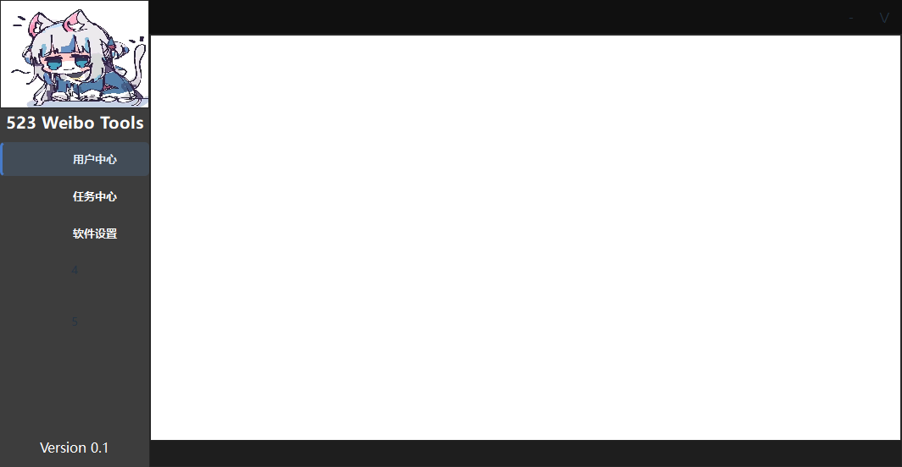

# 侧栏导航与控件层级

按钮可直接关联页面，选择侧栏样式后自动显示悬停、按下和当前页状态。F5 预览与 Python 导出使用相同逻辑，不需要勾选点击事件或编写业务函数。

## 用在现有项目中

1. 在对象树中选中导航按钮。如果上方有标签或图片挡住按钮，右键选择“层级 → 置于顶层”。也可以从菜单栏“排版 → 层级”操作。
2. 在属性面板“导航”分组设置“关联页面”，从下拉框选择“容器 / 页面”。
3. 把“导航样式”设为“侧栏导航（透明底）”。按钮提供圆角透明底、悬停反馈、按下反馈和当前页侧边标记，字体与文字颜色沿用项目设置。
4. 使用独立侧栏控制选择夹时，可在选择夹的“表头”属性中关闭“显示表头”。编辑隐藏页时，仍可通过选择夹“当前页”属性或对象树选中页面。
5. 按 F5 检查切换效果。预览中切页不会修改设计文档的初始页。

推荐直接把文字和图标设置在按钮上。已有“透明按钮覆盖标签”的结构也可以保留，把按钮置顶后，文字区域同样能响应点击。

侧栏样式是可选的；保持“默认”时仍能切页，并保留按钮原来的外观。“外观 → 自定义样式”可以进一步调整颜色、边距；覆盖当前页样式时，可使用 `QAbstractButton[uiplayNavigationActive="true"]` 选择器。

## 支持范围

| 设置 | 支持内容 |
| --- | --- |
| 导航按钮 | 按钮、工具按钮、命令链接按钮 |
| 目标容器 | 选择夹、堆叠窗口、工具箱 |
| 层级操作 | 上移一层、下移一层、置于顶层、置于底层 |
| 多选层级 | 同一容器内自由定位的控件；保留所选控件之间的相对层级 |
| 撤销与保存 | 每次操作可撤销、重做，并随 `.uipro` 保存 |

层级操作不改变位置、大小或对象树顺序。锁定控件、自动布局中的控件、跨容器选择不支持自由层级调整；到达顶层或底层后，对应操作不可用。

页面关联按页面代码名保存。修改页面名称、页标题或拖动页签，不会把按钮关联到其他页面。通过页签或业务代码切页，也会同步导航高亮。导航状态独立于按钮“可选中 / 已选中”，不会占用按钮组的选择状态。

删除目标页面或容器时，其导航关联会一并清除；撤销删除会恢复。一起复制按钮和页面容器时，关联会重映射到新副本。只复制按钮时，外部页面关联会清除，并在状态栏提示。

向导仍使用其前进、后退流程，不列入导航目标。页面关联只切换目标所属容器；嵌套容器的外层页面仍由外层导航管理。

## 万金油UI 示例

打开 [万金油UI_导航增强.uipro](../uidemo/08_万金油UI/万金油UI_导航增强.uipro)，按 F5 即可体验：

| 原按钮 | 关联页面 | 显示标题 |
| --- | --- | --- |
| `button_2` | `tab_page_1` | 用户中心 |
| `button_3` | `tab_page_2` | 任务中心 |
| `button_4` | `tab_page_3` | 软件设置 |

示例保留原有标签和内容，只给前三个导航按钮增加关联、样式和置顶，并隐藏选择夹表头。数字“4”“5”占位按钮没有新增业务行为。增强副本使用独立文档标识；原始 07、08 项目未修改。



## 验证

自动回归覆盖多选层级、边界、锁定、撤销重做、属性面板、复制重映射、保存恢复、三类按钮与三类页面容器、重复刷新、页签排序、删除页面、解除关联、快捷键和样式恢复。

```powershell
python -m pytest tests/test_navigation.py tests/test_stacking.py -q
$env:QT_QPA_PLATFORM = 'windows'
python -X utf8 -m scripts.check_navigation
```

原生检查分别在运行时窗口、真实预览子进程与隔离的导出进程中验证整行点击、连续切页与高亮同步，并生成截图和 [机器可读结果](../reports/navigation-20261111/result.json)。导出进程使用 Python `-I`，不依赖设计器模块。
