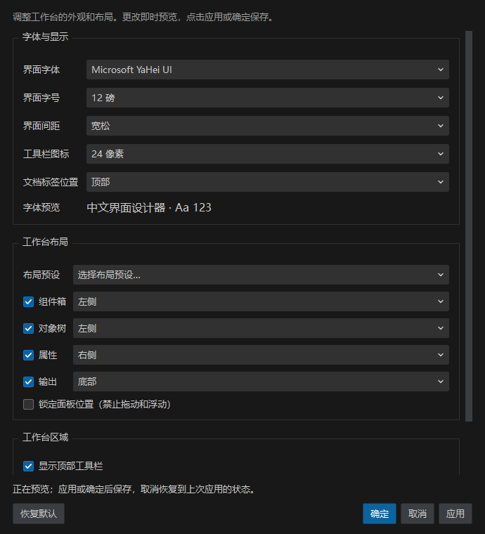
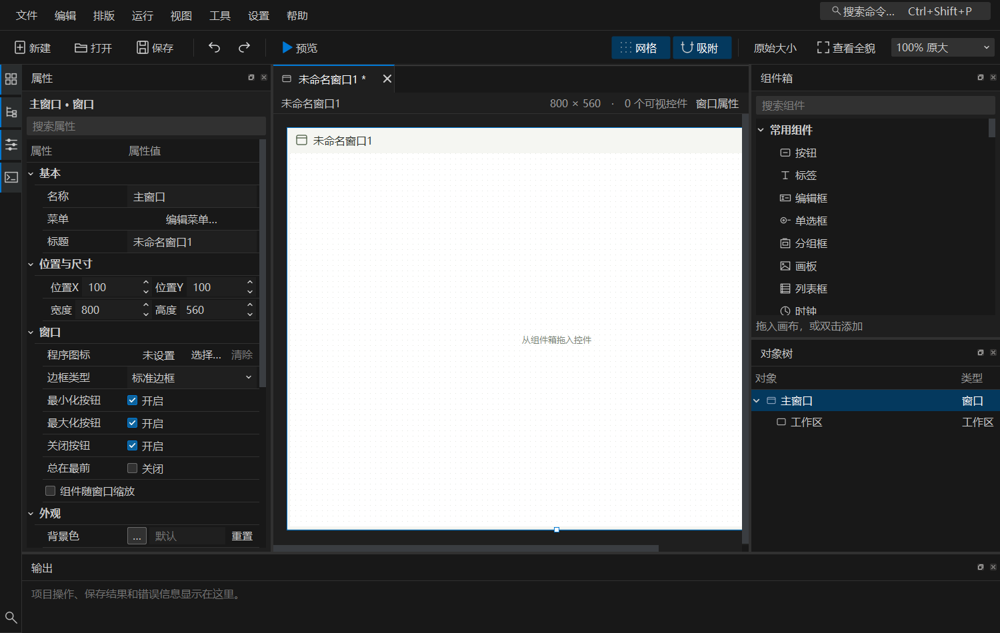

# 工作台设置

从菜单栏“设置 → 工作台设置…”打开，快捷键为 `Ctrl+,`；也可在 `Ctrl+Shift+P` 命令搜索中输入“工作台设置”。

## 可调整内容

| 区域 | 选项 |
| --- | --- |
| 字体与显示 | 本机已安装字体、8–20 磅字号、紧凑/标准/宽松间距、16/20/24/28/32 像素工具栏图标、顶部/底部文档标签 |
| 工作台布局 | 标准布局、紧凑侧栏、右侧组件箱、专注画布 |
| 面板 | 组件箱、对象树、属性、输出的显隐和位置；可停靠在四边或独立浮动 |
| 面板锁定 | 禁止拖动和浮动，已有浮动面板会回到停靠位置；仍允许隐藏面板 |
| 工作台区域 | 顶部工具栏、左侧面板入口栏、底部状态栏的显示与隐藏 |

标准布局将组件箱和对象树放在左侧，属性放在右侧，输出放在底部。紧凑侧栏合并组件箱与对象树为标签页并隐藏输出；右侧组件箱交换两侧面板；专注画布隐藏四个面板。菜单栏“设置 → 布局预设”可以直接切换并保存布局。

面板仍可通过标题栏拖动、通过分隔条调整大小。锁定前可以先安排好位置；关闭面板后，可从“视图”菜单或左侧入口栏重新显示。

## 预览与保存

修改选项后立即在工作台预览。字体预览区域使用所选字体和字号；设置窗口本身保持可读字号，内容较多或屏幕较小时可滚动，底部操作按钮保持可见。

- **应用**：保存当前设置并继续调整。
- **确定**：保存并关闭。回车默认执行确定。
- **取消**、Esc 或窗口关闭按钮：恢复到打开设置窗口时的状态；如果已经点过应用，则恢复到最近一次应用后的状态。
- **恢复默认**：预览默认字体、字号、面板和工具栏布局；应用或确定后才保存，取消仍可还原。

配置保存在当前用户的应用设置中，重启后恢复。窗口位置、大小及手动拖动后的停靠布局仍会在正常退出时保存。损坏或超出范围的偏好字段使用默认值；保存失败会显示原因并允许取消。

这里调整的是设计器工作台，包含菜单、组件箱、对象树、属性面板和输出。设计项目的文本、字体、尺寸、预览结果和导出代码不随之改变。组件字体仍通过右侧属性面板编辑。

默认使用 Microsoft YaHei UI、9 磅、标准间距和 16 像素工具栏图标。字体放大时，组件箱和属性面板的最小宽度及行高同步调整；需要更多画布空间时可使用紧凑或专注布局。

## 截图与验证

设置事务、配置恢复、字体隔离、大字号行高和保存失败路径由 `tests/test_workbench_settings.py` 验证。Windows 实机检查脚本为 `scripts/check_workbench_settings.py`，使用临时配置，不修改个人设置。

完整结果见 [验证记录](../reports/workbench-settings/README.md)。本轮修改源码，历史便携 EXE 未重新打包；使用 `python -X utf8 main.py` 启动当前版本。
