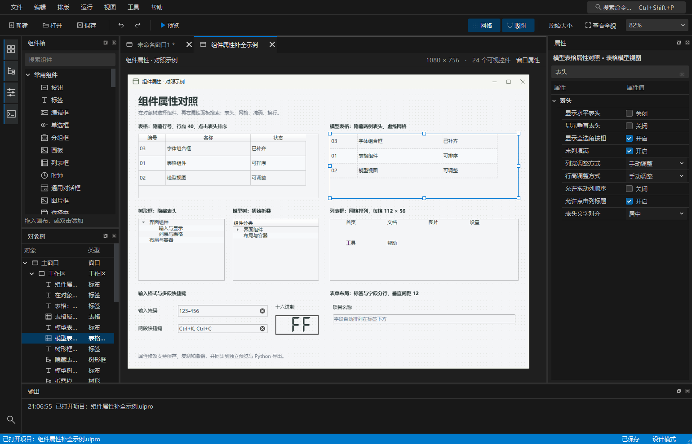
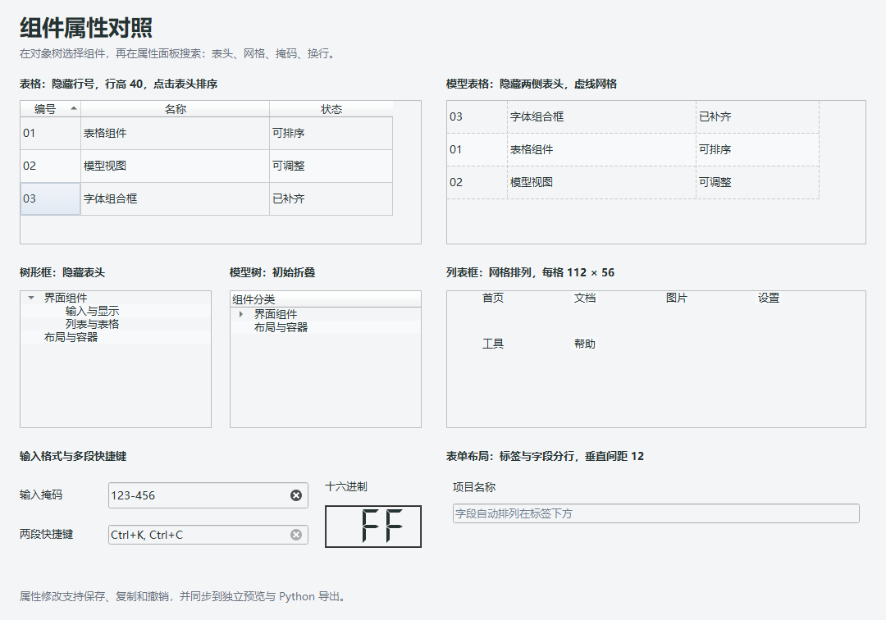

# 组件属性补全验证

验证环境：Windows，Python 3.11.8，PySide6 / Qt 6.11.1。验证日期：2026-11-09。

## 交付范围

核对全部 77 个注册项，其中组件箱可拖放组件 72 类。属性项由 1,668 增至 2,694，新增 1,026 个跨组件属性项；公共属性在不同组件分别计数，不代表 1,026 个独立 Qt 功能。

入口为 [逐组件清单](../../docs/组件属性审计.md)、[机器可读审计](audit.json) 和 [对照示例](../../examples/组件属性补全示例.uipro)。本轮交付源码及示例，未重新打包历史 EXE。

## 已完成验证

- `pytest.xml`：最终全量回归 **1,115 项通过**，0 失败，用时 357.56 秒。
- `composites.xml`：新增组合行为测试和既有属性交互测试，共 64 项通过。包括保存、复制、撤销、独立导出、表格排序数据完整性、表头尺寸、表单换行、输入掩码、快捷键长度、对话框选项和 SVG 隐藏后再显示。
- `verification.json`：Windows 原生预览、属性面板展示、实际修改表头属性及撤销均通过。独立导出在临时目录用 `python -I` 运行，确认不依赖设计器模块。
- `graphics/preview-native.json` 和 `graphics/export-native.json`：Windows Chromium、SVG、OpenGL、RHI、图形视图均通过。JavaScript 返回 42，GPU 帧缓冲像素与设置的清屏色一致；网页图片、本地存储、PDF、字号、背景及 GPU 非默认选项验证通过，已加载组件更新选项也通过。
- `python -X utf8 main.py --smoke-test`：启动检查通过。





## 回归中发现并修复

表格填充时暂停排序，防止一行的数据错位；超级列表框保留明确末列宽度；富文本填充后恢复文档标题；单页页签栏的自动隐藏不再被通用可见性覆盖；布局整体对齐属性不再被误认为布局子项而隐藏。

Windows 图形检查发现 Qt SVG 控件在显示时自动恢复动画。已在显示事件后重新应用用户配置，并增加原生、导出的隐藏再显示回归。

首轮全量测试在 Qt 延迟释放时中止，定位为新增表单面板测试未完整释放独立面板和画布。测试清理已补齐 `deleteLater` 和延迟删除事件处理，原最小复现、64 项组合回归及最终 1,115 项全量回归均通过；未跳过失败用例或削弱断言。

`native-matrix.xml` 与 `regression-initial.xml` 为修复过程中的早期报告，分别记录初期原生属性问题和 375 项相关回归。它们不代表最终源码验收。

## 重现命令

```powershell
python -X utf8 scripts/check_completed_properties.py
python -X utf8 scripts/check_advanced_native.py --mode preview --completed-properties --output reports/property-completion/graphics
python -X utf8 scripts/check_advanced_native.py --mode export --completed-properties --output reports/property-completion/graphics
python -X utf8 -m pytest tests/test_property_completion.py tests/test_property_interactions.py -q --disable-warnings --junitxml=reports/property-completion/composites.xml
python -X utf8 -m pytest -q --disable-warnings --junitxml=reports/property-completion/pytest.xml
python -X utf8 main.py --smoke-test
```

检查脚本加载已有示例，不覆盖用户对示例的修改。图形非默认设置仅应用到检查用内存模型及导出产物。

## 最终源码指纹

`scripts/source_fingerprint.py` 对核心 Python 源码及资源计算的 SHA-256：

```text
61146b171df359d3ce075579c88af571b96a5a4d5a29179c58f7be3fe0103de4
```

该指纹覆盖应用、模型、画布、面板、运行时、布局、预览、导出、注册表和资源；不包含文档、测试脚本及历史 EXE。

## 适用范围

此次补全针对可保存的常用设计属性，不暴露 Qt 的全部 API。只读运行状态、模型和委托对象、外部图形上下文等仍由运行时代码管理。系统对话框和 GPU 行为受操作系统、Qt 和显卡驱动影响；实机验证只代表上述环境。
