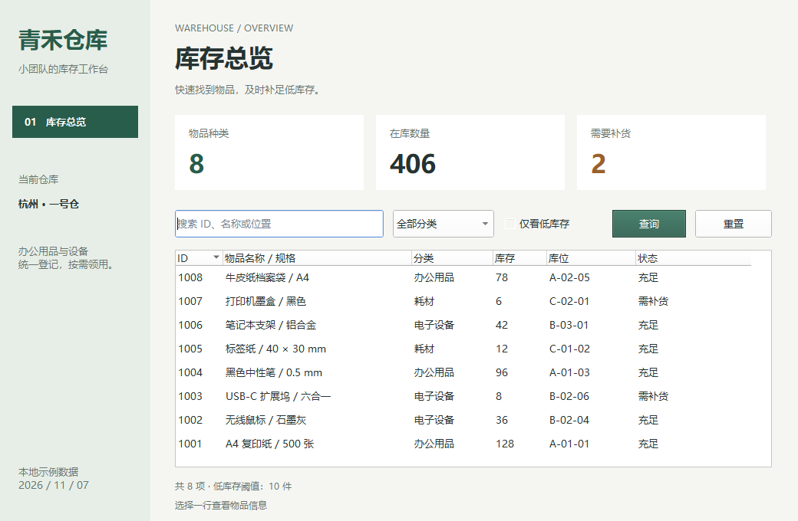
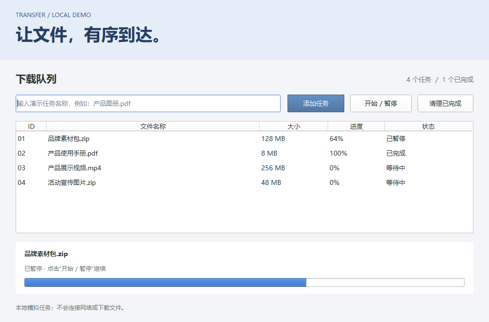
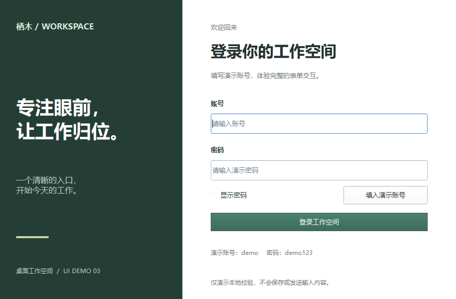
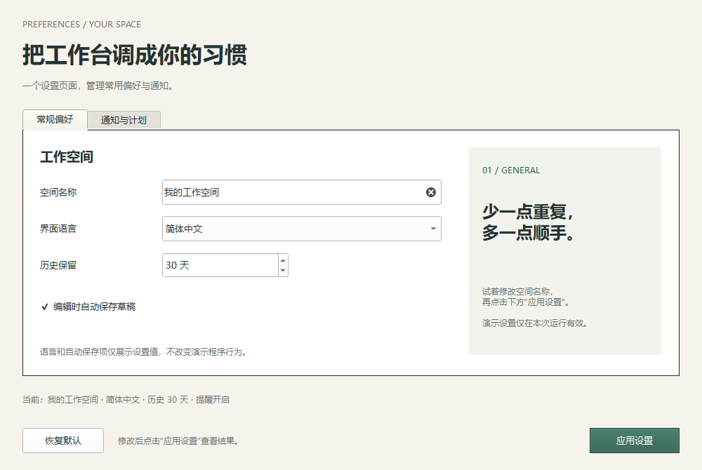
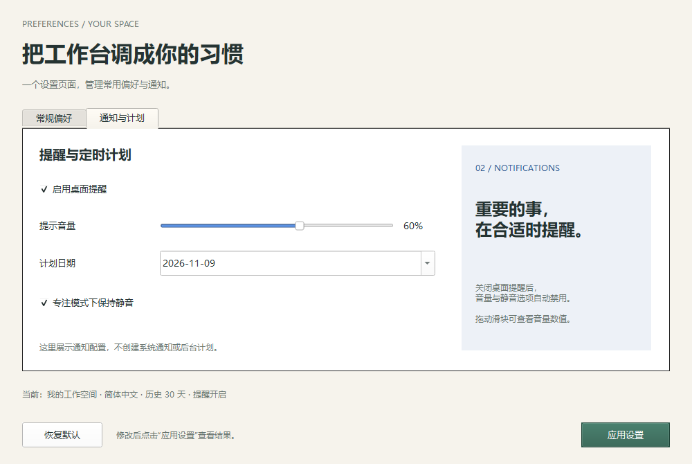
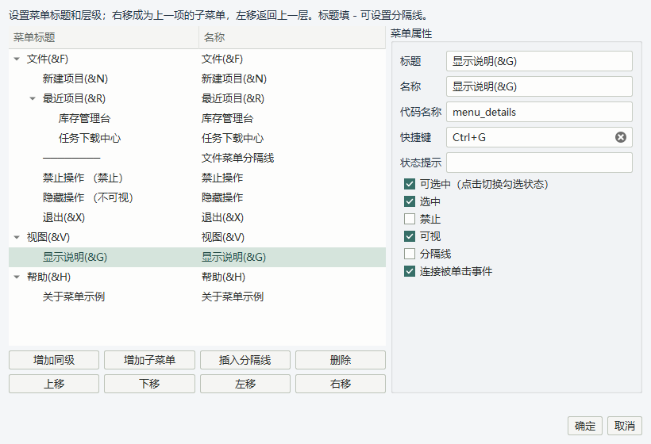
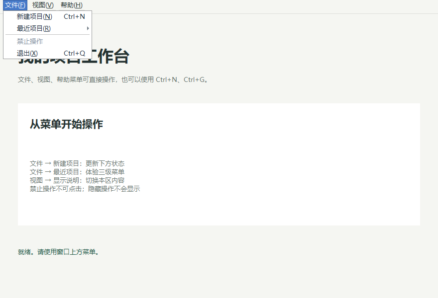
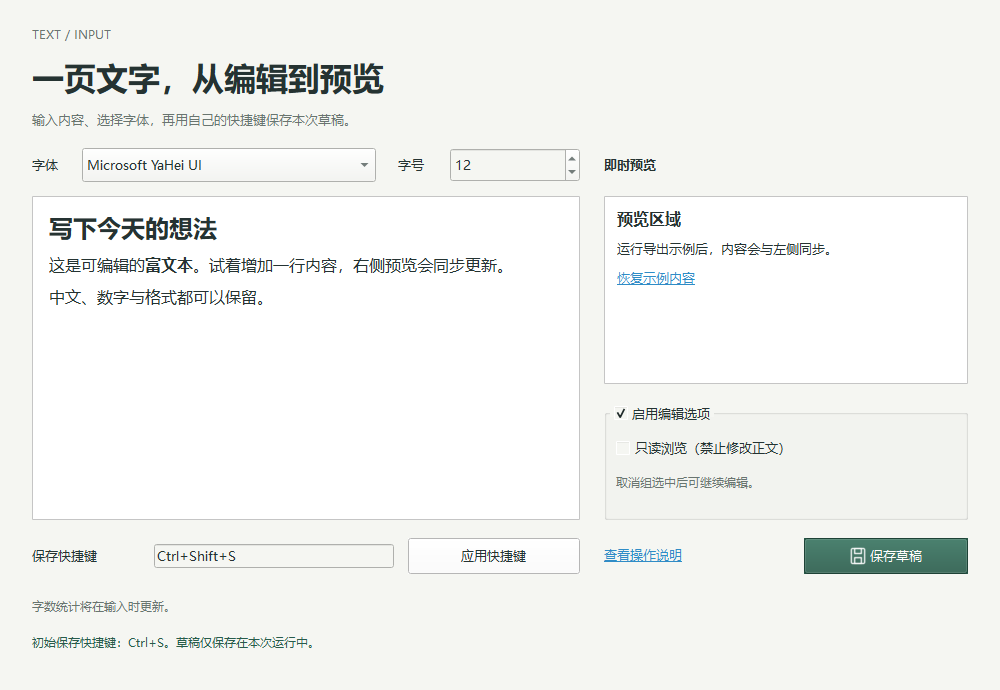
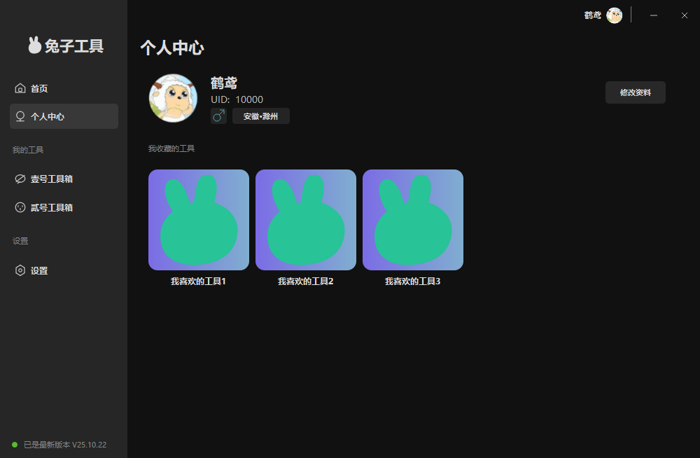

# UI 设计示例

这些界面使用本项目的组件、属性、项目模型和 Python 导出器制作，前四份始于 0.8.1，第五份菜单示例使用 0.9.0，第六份文本与输入示例使用 0.10.0。每份 `.uipro` 都能在设计器里继续编辑、修改属性和勾选事件。

| 编号 | 示例与设计文件 | 主要内容 | 已实现的演示交互 |
| --- | --- | --- | --- |
| 1 | [库存管理台](01_库存管理台/库存管理台.uipro) | 绿色侧栏、统计区、多列超级列表框、窄 ID 列 | 关键词、分类、低库存筛选；重置；选择物品查看信息 |
| 2 | [任务下载中心](02_任务下载中心/任务下载中心.uipro) | 表格、各列宽度、进度条、任务操作区 | 添加任务、开始/暂停、模拟进度、清理完成任务 |
| 3 | [账号登录](03_账号登录/账号登录.uipro) | 分栏登录界面、密码框、显示密码开关 | 空值校验、显示/隐藏密码、填入演示账号、回车提交 |
| 4 | [应用设置](04_应用设置/应用设置.uipro) | 两页选择夹、数值输入、日期、滑块、选择框 | 通知开关联动、实时音量、应用设置、恢复默认 |
| 5 | [菜单编辑示例](05_菜单编辑示例/菜单编辑示例.uipro) | 三级菜单、分隔线、选中、禁止、隐藏和快捷键 | 新建计数、最近项目选择、显示/隐藏说明、退出 |
| 6 | [文本与输入组件](06_文本与输入组件/文本与输入组件.uipro) | 富文本、文本浏览器、字体、快捷键、图标按钮和勾选分组 | 同步预览、切换字体字号、只读联动、修改保存快捷键、恢复正文 |
| 7 | [兔子工具个人中心](07_兔子工具个人中心/兔子工具个人中心.uipro) | 仿参考图的深色侧栏、用户资料、三张兔子卡片、无边框标题栏 | 导航切换、修改资料与取消、卡片提示、拖动标题栏、最小化和关闭 |

菜单示例：`python -X utf8 uidemo/run_demo.py 5` 运行，追加 `--edit` 在设计器中编辑；通过“工具 → 菜单编辑器”设置菜单。`Ctrl+N` 新建计数、`Ctrl+G` 切换说明。业务代码见 `05_菜单编辑示例/Python导出/menus_demo.py`。

文本示例：`python -X utf8 uidemo/run_demo.py 6` 运行，追加 `--edit` 编辑。初始用 Ctrl+S 保存本次运行的草稿，可录入其他组合键并点击“应用快捷键”。关闭窗口后清除草稿；业务代码见 `06_文本与输入组件/Python导出/text_inputs_demo.py`。预览中的恢复链接、标签操作说明和事件勾选均有对应处理函数。

## 在设计器里打开

启动项目根目录的 `main.py`，使用“文件 → 打开”选择上表中的 `.uipro` 文件。

也可以在项目根目录执行以下命令直接打开第一个示例，将 `1` 换成 `2` 至 `7` 即可切换：

```powershell
python -X utf8 uidemo/run_demo.py 1 --edit
```

选择组件后，可在属性面板编辑文字、颜色、字体、位置和尺寸。调整列宽的入口是“表格内容 / 表项与列 → 编辑 → 当前列 / 列宽”。事件面板中的勾选状态已经保存到各示例项目中。

设计器打开后默认是原大画布；工作区放不下时，可点击“查看全貌”或按 `Ctrl+9`。前六份设计尺寸依次为 1040 × 680、1000 × 660、900 × 590、1000 × 670、880 × 600、1000 × 690 逻辑像素，采用当前设计器的绝对定位方式。

第七份个人中心尺寸为 1000 × 654，参考 `reports/QQ20261109-153349.jpg`，保留原图的布局比例、深色配色和留白。头像取自参考图，兔子卡片和导航图标重新绘制；文字、图片、按钮均为独立可编辑组件。运行 `python -X utf8 uidemo/run_demo.py 7`，追加 `--edit` 在设计器内编辑。

按 `F5` 预览布局、输入和事件触发。设计器预览不执行导出目录里的业务函数；下面的运行方式可体验筛选、进度模拟等演示交互。

## 运行交互示例

使用当前项目已安装的 Python 与 PySide6 环境，在项目根目录运行：

```powershell
python -X utf8 uidemo/run_demo.py 1
python -X utf8 uidemo/run_demo.py 2
python -X utf8 uidemo/run_demo.py 3
python -X utf8 uidemo/run_demo.py 4
python -X utf8 uidemo/run_demo.py 5
python -X utf8 uidemo/run_demo.py 6
python -X utf8 uidemo/run_demo.py 7
```

也可直接运行各目录下的 `Python导出/main.py`。每个 `Python导出` 都包含完整运行代码，可单独复制到其他目录；运行依赖见其中的 `requirements.txt`。

登录示例账号为 `demo`，密码为 `demo123`。任务中心只模拟进度，不访问网络。库存数据为本地演示数据；应用设置只在本次运行有效，不写入系统设置。语言、自动保存和日期选项用于展示表单配置，不实际切换语言、保存草稿或创建后台计划。

## 修改界面与交互

修改 `.uipro` 后，通过设计器“文件 → 导出 Python 项目”导出到对应的 `Python导出` 目录，再重新运行。重新导出会保留现有演示业务文件。

- `handlers.py`：初始化入口。
- `event_handlers/`：与设计器勾选事件对应的处理函数。
- `inventory_demo.py`、`tasks_demo.py`、`login_demo.py`、`settings_demo.py`、`menus_demo.py`、`text_inputs_demo.py`：各自示例的交互逻辑。
- `generated/` 与 `current.json`：设计器生成和管理的界面代码。

事件函数通过组件代码名称访问控件。调整显示文字、颜色、大小不会影响这些引用；删除控件或更换代码名称时，需要同步调整演示逻辑。

`build_examples.py` 保留制作这些界面的代码，调用当前项目的模型、注册表、属性命令、截图运行时和导出器。运行时优先读取已有设计文件，不覆盖已经修改的 `.uipro` 或业务文件；`logic/` 是新建示例时使用的业务模板。

```powershell
python -X utf8 uidemo/build_examples.py
```

## 预览

### 库存管理台



### 任务下载中心



### 账号登录



### 应用设置





### 菜单编辑示例





每个示例目录还包含 `设计器.png`，展示项目在本设计器内打开后的状态。

### 文本与输入组件



### 兔子工具个人中心



资料修改仅在本次运行有效，三张卡片展示工具入口提示。业务模板为 `logic/profile_demo.py`，制作代码为 `profile_example.py`。只生成此示例用 `python -X utf8 uidemo/build_examples.py --only 7`，保留已有设计文件和业务文件。

## 验证

```powershell
python -X utf8 uidemo/check_examples.py
python -X utf8 uidemo/check_examples.py --standalone
python -X utf8 uidemo/check_examples.py --only 7
python -X utf8 uidemo/check_examples.py --standalone --only 7
```

2026 年 11 月 7 日在 Windows、100% 缩放下验证通过：六份项目均能在 0.10.0 设计器中打开、修改属性并撤销、取消事件勾选并撤销；六份导出均能启动并完成上表列出的交互。另检查了控件是否超出父容器、标签文字尺寸、各列实际宽度，以及运行交互后原始设计文件没有变化。检查使用 Qt 合成鼠标和键盘输入，结果见 [验证结果.json](验证结果.json)。

独立运行检查仅复制各自的 `Python导出` 到仓库外临时目录，清除 Python 搜索路径环境变量并使用 `python -I` 启动，验证不需要设计器源码。结果见 [独立运行验证.json](独立运行验证.json)。
